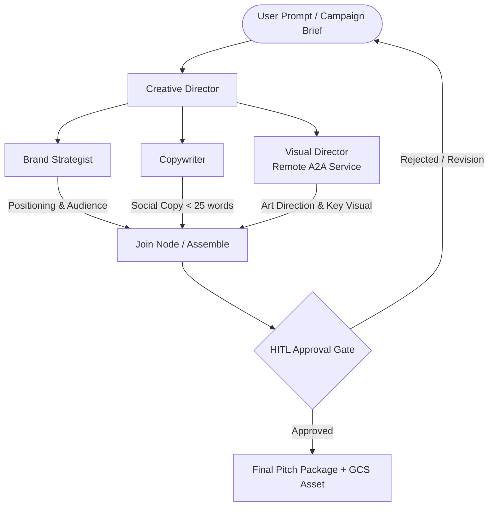

# 🚀 Gemini Multi-Agent Pitch Generator

[](https://www.python.org/)
[-4285F4?style=flat&logo=google&logoColor=white)](https://cloud.google.com/vertex-ai)
[](https://deepmind.google/technologies/gemini/)
[](https://fastapi.tiangolo.com/)
[](https://cloud.google.com/run)
[](LICENSE)

An enterprise-grade, multi-agent marketing campaign and pitch deck generator built with **Google Agent Development Kit (ADK)**, **Gemini 3.8 Flash**, **Agent-to-Agent (A2A) Protocol**, and **Google Cloud Platform**.

---

## 🌟 Overview

The **Gemini Multi-Agent Pitch Generator** orchestrates a collaborative team of specialized autonomous AI agents to transform a raw marketing concept into a complete, brand-compliant creative campaign package—including strategic positioning, social copy, art direction, and synthesized key visual assets.

Built on Google's modern agentic patterns, it integrates enterprise guardrails, lifecycle hooks, tokenomics optimization, BigQuery telemetry, and human-in-the-loop (HITL) approval gates.

---

## 🏗️ Architecture & Agent Workflow



### 🤖 Specialist Agents

| Agent | Role & Responsibility | Output Key |
| :--- | :--- | :--- |
| **Creative Director** | Analyzes the initial brief and formulates a single punchy concept line with strategic rationale. | `creative_director` |
| **Brand Strategist** | Defines target demographic, market positioning, tone of voice, and brand alignment. | `brand_strategist` |
| **Copywriter** | Crafts high-energy social captions (strictly under 25 words) with clear calls to action. | `copywriter` |
| **Visual Director** | Synthesizes 16:9 key visuals and art direction via remote Agent-to-Agent (A2A) microservice. | `visual_director` |

---

## ✨ Key Features

- **Google Agent Development Kit (ADK) Orchestration**: Directed Acyclic Graph (DAG) workflow with `LoopGuard` cycle detection and parallel branch execution.
- **Agent-to-Agent (A2A) Protocol**: Decoupled visual synthesis service exposing `/.well-known/agent-card.json` and communicating over authenticated JSON-RPC.
- **Dynamic Skills & Brand Guidelines**: Ingests and enforces brand style guides (`pitch_generator/skills/brand-guidelines/SKILL.md`) with continuous adherence evaluation.
- **Enterprise Safety & Lifecycle Hooks**:
  - `PreToolUse` lifecycle hooks for PII scrubbing and prompt injection defense.
  - Human-in-the-Loop (`HITL`) gate allowing manual review and revision before asset generation.
- **Production Tokenomics**:
  - Automatic prompt caching, history pruning, and token compression to maximize throughput and minimize latency.
- **Full Observability & Analytics**:
  - Live streaming telemetry to **Google BigQuery** (`agent_events`) for cost, token, and latency tracking.
  - Media asset storage and persistent caching in **Google Cloud Storage (GCS)**.
- **Dual Interfaces**:
  - Modern web frontend with interactive campaign preview and approval workflows.
  - High-performance CLI for headless automated batch executions (`call_agent.py`).

---

## 📂 Project Structure

```text
├── AGENTS.md                          # Repository instructions & agent guideposts
├── Dockerfile                         # Container build definition for Cloud Run
├── README.md                          # Project documentation
├── call_agent.py                      # Canonical CLI execution interface
├── pyproject.toml                     # Python dependencies & build metadata
├── frontend/                          # Interactive web frontend (HTML/CSS/JS)
├── pitch_generator/                   # Core application package
│   ├── agent.py                       # Specialist agents, ADK DAG workflow, A2A handlers
│   ├── config.py                      # Environment configuration knobs
│   ├── fast_api_app.py                # FastAPI REST server & ASGI frontend handler
│   ├── app_utils/                     # Shared ADK shims, A2A connectors, BigQuery services
│   └── skills/                        # Modular agent skills (e.g. brand-guidelines)
├── scripts/
│   ├── deploy.sh                      # Automated deployment to Cloud Run
│   └── setup.sh                       # GCP resource provisioning (GCS, BigQuery, IAM)
└── tests/                             # Pytest test suite & lab step verifications
```

---

## 🚀 Getting Started

### 1. Prerequisites

- Python 3.11+
- [Google Cloud SDK (`gcloud`)](https://cloud.google.com/sdk/docs/install) authenticated:
  ```bash
  gcloud auth login
  gcloud auth application-default login
  ```
- A Google Cloud Project with Vertex AI & Cloud Run APIs enabled.

### 2. Installation

Clone the repository and set up a virtual environment:

```bash
git clone https://github.com/gustygnm/gemini-multi-agent-pitch-generator.git
cd gemini-multi-agent-pitch-generator

python3 -m venv .venv
source .venv/bin/activate
pip install -e .
```

### 3. Environment Configuration

Copy the example environment template and configure your GCP project settings:

```bash
cp .env.example .env
```

Edit `.env` with your project variables:
```dotenv
PROJECT_ID=your-gcp-project-id
GOOGLE_CLOUD_PROJECT=your-gcp-project-id
GOOGLE_CLOUD_REGION=us-central1
GOOGLE_CLOUD_LOCATION=global
GOOGLE_GENAI_USE_ENTERPRISE=TRUE
LOGS_BUCKET_NAME=your-gcp-project-id-bwg
MEMORY_BANK_ID=pitch-generator-memory
VISUAL_DIRECTOR_URL=http://localhost:8801
PITCH_GENERATOR_URL=http://localhost:8080
FLASH_MODEL=gemini-3.8-flash
IMAGE_MODEL=gemini-nano-banana-2.1
```

### 4. GCP Infrastructure Setup

Automatically provision required GCS buckets, BigQuery datasets, and IAM policies:

```bash
bash scripts/setup.sh
```

---

## 💻 Running the Application

### Option A: Local Web Server (Recommended)

Start the Pitch Generator web server on port `8080` (and standalone Visual Director A2A service on `8801`):

```bash
bash .agents/skills/start-frontend/scripts/start_server.sh --with-visual-director
```

- **Web UI**: [http://localhost:8080](http://localhost:8080)
- **A2A Agent Card**: [http://localhost:8801/.well-known/agent-card.json](http://localhost:8801/.well-known/agent-card.json)
- **Health Check**: `curl http://localhost:8080/healthz`

### Option B: CLI Direct Invocations

Run a single pitch campaign directly from the command line:

```bash
python3 call_agent.py "Flying skateboards for cats"
```

Save the generated key visual image locally:
```bash
python3 call_agent.py "Eco-friendly underwater coffee shop" --save-image ./key_visual.png
```

---

## 🧪 Testing & Verification

Run the comprehensive unit and integration test suite:

```bash
pytest
```

To run module-specific verification tests:
```bash
pytest tests/test_module_1.py
pytest tests/test_module_2.py
pytest tests/test_module_3.py
pytest tests/test_module_4.py
```

---

## ☁️ Cloud Run Deployment

Deploy both the `visual-director` A2A microservice and the `pitch-generator` full-stack application to Google Cloud Run:

```bash
bash scripts/deploy.sh
```

The script will automatically:
1. Verify authentication and prerequisites.
2. Build container images via Cloud Build.
3. Deploy the `visual-director` service and export its HTTPS URL.
4. Deploy the `pitch-generator` service wired with `VISUAL_DIRECTOR_URL`.
5. Output live production service URLs.

---

## 📄 License

This project is licensed under the [Apache License 2.0](LICENSE).
